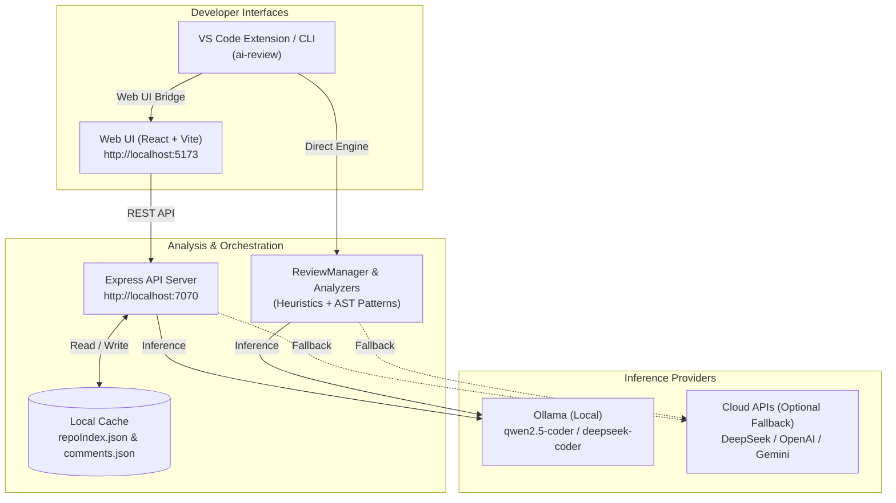

# AI Code Review Assistant

[](https://nodejs.org/)
[](https://www.typescriptlang.org/)
[](https://react.dev/)
[](https://ollama.com/)

An intelligent, local-first code review platform designed for privacy, speed, and accuracy. Analyze single files, staged git diffs, or entire GitHub repositories using local LLMs (via Ollama) or optional cloud providers (DeepSeek, OpenAI, Google Gemini). Includes a modern web interface, a standalone CLI tool, and an optional VS Code extension.

---

## ✨ Features

- 🏠 **Local-First & Private**: Runs completely on your machine via Ollama (`qwen2.5-coder:7b`, `deepseek-coder`, `llama3`). Zero telemetry, zero cloud costs.
- ☁️ **Flexible Cloud Fallback**: Optional integration with OpenAI (`gpt-4o-mini`), DeepSeek, or Google Gemini when local compute is unavailable.
- 🌐 **Modern Web Console**: Interactive two-panel web UI featuring code editing, live metrics, multi-file guideline merging, and comment threads.
- 🔄 **Incremental & Full Repo Reviews**: Clone and review public GitHub repositories. Cache files by SHA-256 hash in `backend/data/repoIndex.json` to review only modified/new files (`changedOnly`).
- 🎯 **Line-by-Line Code Analysis**: Mandatory exact line citations, before/after corrected code snippets, severity tags (`CRITICAL`, `HIGH`, `MEDIUM`, `LOW`), effort estimates (`S`, `M`, `L`), and doc recommendations.
- 📋 **Project Guidelines Awareness**: Paste custom guidelines or upload multiple rules files (`.eslintrc`, `pyproject.toml`, `.editorconfig`, Markdown, JSON) with automatic merging.
- 💬 **Discussion & Comments Thread**: Anchor review notes and comments to specific files and line numbers.
- 🔌 **VS Code Extension & Standalone CLI**:
  - Run reviews directly inside VS Code with `Ctrl+Shift+R`.
  - Block problematic commits before they hit your repo via `ai-review --staged` pre-commit hooks.

---

## 🏗️ System Architecture



---

## 🚀 Quick Start (Windows)

### 1. Prerequisites
- **Node.js** 18+ and **npm** 9+ ([Download Node.js](https://nodejs.org/))
- **Git** ([Download Git](https://git-scm.com/))
- **Ollama** ([Download Ollama](https://ollama.com/))

Pull the recommended code review model:
```bash
ollama pull qwen2.5-coder:7b
```

### 2. One-Click Start
Double-click **`start_all.bat`** from the root of the repository. This will:
1. Verify that the Ollama service is active (or launch it).
2. Check for the `qwen2.5-coder:7b` model.
3. Install backend and web dependencies automatically if missing.
4. Launch the Backend API on `http://localhost:7070`.
5. Launch the Web UI on `http://localhost:5173`.
6. Open your default web browser to the application dashboard.

To stop all services and free the ports, double-click **`stop_all.bat`**.

---

## 💻 Manual Setup & Cross-Platform (macOS / Linux)

### 1. Install Dependencies
```bash
# Install root extension dependencies
npm install

# Install backend dependencies
cd backend && npm install && cd ..

# Install web UI dependencies
cd web && npm install && cd ..
```

### 2. Start Backend & Web UI
Open two separate terminal tabs:

**Terminal 1 (Backend API):**
```bash
cd backend
npm run dev
# Running on http://localhost:7070
```

**Terminal 2 (Web UI):**
```bash
cd web
npm run dev
# Running on http://localhost:5173
```

---

## 🖥️ Using the Standalone CLI & Pre-commit Hook

### Run Code Review via CLI
You can review staged Git changes directly from your terminal:
```bash
# Compile the TypeScript extension/CLI once:
npm run compile

# Review staged files:
node out/cli/review-cli.js --staged
```

### Git Pre-Commit Hook
Prevent critical code issues from ever being committed:
```bash
# In Linux/macOS or Git Bash:
cat << 'EOF' > .git/hooks/pre-commit
#!/bin/sh
node "./out/cli/review-cli.js" --staged || {
  echo "AI review detected critical issues. Commit aborted."
  exit 1
}
EOF
chmod +x .git/hooks/pre-commit
```
*(Or install the hook with one click from inside VS Code via the Command Palette: `AI Code Review: Install Git pre-commit hook`)*.

---

## 📖 Web UI Walkthrough

1. **Single File Review (Left Panel)**:
   - Paste code into the editor.
   - Choose a language from the **Lang** dropdown (Auto-detect, Python, JavaScript, TypeScript, Java, Go, Rust, C++, C#, or General Q&A).
   - Adjust the **Temperature** slider (0.0 for strict deterministic linting, 0.5+ for creative solutions).
   - Click **Review Code**.
2. **Project Guidelines & Rules**:
   - Upload multiple rule files (`.md`, `.eslintrc`, `pyproject.toml`, `.json`) using the **Upload Guidelines** button. Files are automatically merged.
   - Or paste custom guidelines directly into the guidelines textarea.
3. **Review Any GitHub Repository (Right Panel)**:
   - Enter any repository identifier (`owner/repo` or full URL `https://github.com/owner/repo`).
   - Toggle **Changed only** for incremental reviews (skips unchanged files via SHA-256 hashing).
   - Click **Review Repo**.
4. **Findings & Discussion Thread**:
   - Review issues appear in the left panel's findings navigator with color-coded severity badges.
   - Click **Comment** next to any finding to pre-populate file and line coordinates in the repository comments thread.

---

## ⚙️ Configuration & Custom Rules

### Environment Variables
Configure backend behavior via environment variables or a `.env` file in `backend/`:

| Variable | Default | Description |
| :--- | :--- | :--- |
| `PORT` | `7070` | Port for the backend API |
| `OLLAMA_URL` | `http://localhost:11434` | URL of the local Ollama daemon |
| `OLLAMA_MODEL` | `qwen2.5-coder:7b` | Default Ollama model to invoke |
| `ALLOW_CLOUD` | `false` | Enable fallback to OpenAI when Ollama is offline |
| `OPENAI_API_KEY`| *(empty)* | OpenAI API key for cloud fallback (`gpt-4o-mini`) |
| `DEEPSEEK_API_KEY`| *(empty)* | Optional DeepSeek API key for VS Code extension |
| `GEMINI_API_KEY` | *(empty)* | Optional Google Gemini API key for VS Code extension |

### Custom Patterns (`code-review.config.json`)
Define custom static analysis rules in the workspace root:

```json
{
  "patterns": [
    {
      "name": "No console.log",
      "regex": "console\\.log",
      "severity": "warning",
      "message": "Remove debug logging statements before committing.",
      "guideline": "Team Production Policy",
      "tags": ["style", "clean-code"]
    },
    {
      "name": "No Hardcoded Secrets",
      "regex": "(password|secret|api_key)\\s*=\\s*['\"][^'\"]+['\"]",
      "severity": "critical",
      "message": "Potential credential exposure. Use environment variables.",
      "guideline": "OWASP A02: Cryptographic Failures",
      "tags": ["security"]
    }
  ]
}
```

---

## 🧪 Testing & Verification

Run the included verification scripts to validate backend health, language detection, and incremental change tracking:

```bash
# 1. Quick sanity test (checks backend health and single review)
python quick_test.py

# 2. Comprehensive enhancements test (language detection, prompt strictness, incremental tracking)
python test_enhancements.py
```

### Try Demo Vulnerability Files
Inspect the bundled demo targets in `demo/`:
- `demo/buggy_python.py`: SQL injection, hardcoded passwords, unsafe `eval()`, bare `except:`.
- `demo/buggy_javascript.js`: `var` usage, loose equality (`==`), active `console.log`.
- `demo/buggy_typescript.ts`: `any` types, loose type safety, unsafe assertions.

---

## 📁 Repository Structure

```
Haufe-Internship-2025/
├── backend/                   # Node.js + Express TypeScript API
│   ├── src/
│   │   └── server.ts          # REST endpoints, Ollama/OpenAI routing, git cloning
│   ├── data/                  # Persistent cache (repoIndex.json, comments.json)
│   ├── package.json
│   └── tsconfig.json
├── web/                       # React + Vite Web Application
│   ├── src/
│   │   ├── App.tsx            # Interactive review dashboard & comment threads
│   │   ├── main.tsx           # Entry point
│   │   └── styles.css         # Modern dark-theme styling
│   ├── index.html
│   ├── package.json
│   └── vite.config.ts
├── src/                       # VS Code Extension & CLI Engine
│   ├── analyzers/             # Language-specific heuristics (Python, JS, TS)
│   ├── cli/                   # Standalone review-cli.js (ai-review --staged)
│   ├── llm/                   # Multi-provider LLM router (Ollama, DeepSeek, OpenAI, Gemini)
│   ├── panels/                # VS Code Webview review panel
│   ├── services/              # ReviewManager core orchestration & Git diff parser
│   └── extension.ts           # VS Code extension entry point
├── demo/                      # Sample buggy files for testing
│   ├── buggy_python.py
│   ├── buggy_javascript.js
│   └── buggy_typescript.ts
├── scripts/                   # Resilient process runners (run_backend.bat, run_web.bat)
├── start_all.bat              # One-click Windows launcher (Ollama + Backend + Web)
├── stop_all.bat               # Clean process terminator for Windows
├── quick_test.py              # Backend health and review verification script
├── test_enhancements.py       # Multi-feature automated test suite
├── code-review.config.json    # Workspace custom linting rules
├── HACKATHON.md               # Technical specification and architecture overview
└── README.md                  # Project documentation
```

---

## ❓ Troubleshooting

| Issue | Resolution |
| :--- | :--- |
| **Port 7070 or 5173 in use** | Run `stop_all.bat` or kill existing node processes: `Stop-Process -Name node -Force` in PowerShell. |
| **Ollama shows offline** | Ensure the Ollama background daemon is running by opening a terminal and typing `ollama serve`. |
| **Model not found error** | Download the model via `ollama pull qwen2.5-coder:7b`. You can also select another model from the dropdown. |
| **Git clone error on repo review** | Ensure `git` is installed and available in your system `PATH`. Private repositories require configured SSH keys or git credential helper. |

---

## 📄 Documentation

- **Technical Specification**: See [HACKATHON.md](./HACKATHON.md) for architecture deep-dives and pipeline specifications.
